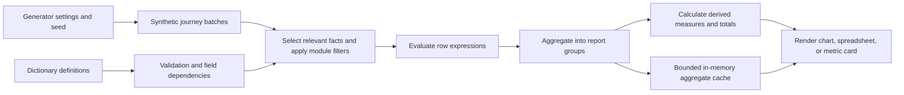

# Subscription Data Studio — Mechanics

This document explains the current implementation as of November 23, 2026. It covers how the dictionary becomes calculations, how records become report values, and what happens when filters or Refresh are used. Examples use synthetic data.

## Contents

1. [The complete data flow](#1-the-complete-data-flow)
2. [Generated data and relationships](#2-generated-data-and-relationships)
3. [How the Data Dictionary works](#3-how-the-data-dictionary-works)
4. [How calculations are tabulated](#4-how-calculations-are-tabulated)
5. [How dictionary fields populate Reporting](#5-how-dictionary-fields-populate-reporting)
6. [How report types populate](#6-how-report-types-populate)
7. [How filters work](#7-how-filters-work)
8. [How Refresh and Recalculate work](#8-how-refresh-and-recalculate-work)
9. [Sample evaluation versus full-data reports](#9-sample-evaluation-versus-full-data-reports)
10. [Saving, exports, and portability](#10-saving-exports-and-portability)
11. [Troubleshooting and current limitations](#11-troubleshooting-and-current-limitations)
12. [Calculation reliability tools](#12-calculation-reliability-tools)
13. [Where to find the implementation](#13-where-to-find-the-implementation)

## 1. The complete data flow



The Generator supplies records. The Data Dictionary describes how to interpret those records. A report module supplies the axes, filters, presentation settings, and chart type.

Reports calculate across the generated journey run, not just the preview rows visible in the Generator or Dictionary card samples. Large runs retain the seed, snapshot date, options, and other run inputs so records can be regenerated deterministically in batches.

## 2. Generated data and relationships

| Table | Grain — what one row represents | Typical use |
|---|---|---|
| `user_records` | One user | Acquisition and demographics |
| `subscription_records` | One subscription | Plan, lifecycle, subscription revenue |
| `transaction_records` | One captured financial transaction | Charges, discounts, taxes, refunds, chargebacks |
| `scheduled_subscription_payment_records` | One scheduled payment | Renewal schedules and payment outcomes |
| `failed_transactions` | One failed payment attempt | Failure reasons and retry activity |
| `subscription_change_records` | One recorded subscription change | Status history, upgrades, downgrades |
| `marketing_records` | One campaign/source on a day | Spend and applicable marketing activity |

Users can have multiple subscriptions over time. Subscriptions connect to transactions, schedules, changes, and failed attempts through their IDs. Marketing attribution connects through campaign source and name. The application's relationship panel describes these connections; it is not an arbitrary SQL JOIN editor.

The grain matters. Counting subscription records counts subscriptions; counting transaction records counts transactions. Summing a subscription's lifetime revenue once for every transaction would duplicate that revenue.

For the underlying billing rules, see [Subscription Data Studio Logic](subscription_data_studio_logic.md). For the tab overview, see [Tab Mechanics Guide](SUBSCRIPTION_DATA_STUDIO_GUIDE.md).

### Generation and memory

- Launch defaults are 50,000 users and five years of history; the supported user-count ceiling is 500,000.
- A seed, snapshot date, and identical options reproduce the same journeys.
- Generation preserves 250-user seed boundaries so IDs and exported records stay consistent.
- Generation and integrity checks run in a background worker when supported, with a local fallback.
- Large worker runs return counts, dimension values, and preview rows to the page instead of transferring every generated record.
- Small runs can retain CSV/JSON data. Larger CSV exports regenerate and stream records from the same run inputs.

## 3. How the Data Dictionary works

### Definitions and names

Each definition has an individual collapsed card. Cards are stacked within label folders, arranged by Dimensions, Dates and Measures; existing parameters have their own group. Opening a card exposes its LookML-style definition and Apply, Duplicate, Evaluate Sample and Remove actions. Close Evaluator appears while evaluation results are open. SQL and property suggestions use the Studio’s font, flat charcoal buttons and contrasting text. Label folders sort alphabetically, as do definition names within them. New-definition buttons create editable drafts.

The card editors accept a LookML-style syntax implemented by this application. It supports a defined subset of SQL-style expressions; it is not a full Looker or SQL database engine.

```lookml
dimension: state {
  label: "Geography"
  type: string
  sql: ${user_records.state} ;;
}

date: subscription_start_dt {
  label: "Dates"
  type: date
  sql: DATE(${subscription_records.subscription_start_ts}) ;;
}

measure: total_subscriptions {
  label: "Subscription"
  type: count_distinct
  sql: ${subscription_records.subscription_id} ;;
  value_format: numeric
}
```

- The identifier after `dimension:`, `date:`, or `measure:` is the field's name.
- `label:` organizes fields into folders. Multiple definitions can share a label.
- Names must be unique within their definition category. Shared labels do not create duplicate-name errors.
- Dimensions resolve as string or date fields. Numerically shaped dimension values can still sort numerically.
- Dates are stored among the custom attributes and displayed in the Dates group.
- Measures specify numeric aggregation and display formatting.
- `${table.column}` references an underlying column.
- `;;` terminates the SQL expression.

### Saving definitions

Save Definitions parses the blocks, validates table/column references and supported syntax, resolves dependencies, and updates the saved dictionary fields. Definitions can reference other saved or resolvable definitions. Circular references are rejected or guarded during evaluation.

A successful save updates the reporting palette, records definition history, and marks existing reports for refresh. Browser-local persistence is used, and the dictionary sidecar file can also be updated through the supported file-saving workflow. File permission or cancellation messages should be read separately from browser-save status.

Editing a card updates only its draft. Apply validates that one card against the committed Dictionary, publishes it independently, and re-sorts its card if its label, name or type changed. Invalid sibling drafts are not published. A failed Apply leaves committed definitions unchanged and shows an inline error. Save definitions validates and publishes the complete draft. Evaluate Sample previews the card in its sibling-definition context without publishing the draft. Comments and parameter blocks remain in the canonical saved source.

### References to existing definitions

Measures can use other measures with double braces:

```lookml
measure: reactivation_rate {
  label: "Subscription"
  type: number
  sql: {{reactivations}} / {{total_subscriptions}} ;;
  value_format: percent
}
```

Derived dimensions can reference dictionary dimension names using the supported dimension-reference syntax, such as `${state}`, after that name is defined. Physical table columns use the unambiguous `${table.column}` form. See the editor's context suggestions for available names and supported functions.

### Functions and operators

The expression engine supports arithmetic, CASE, comparisons, logical predicates, IN/NOT IN, NULL checks, BETWEEN, LIKE, and a collection of date, string, and numeric functions. Examples include DATE, TIMESTAMP, YEAR, MONTH, DATE_TRUNC, DATEDIFF, DATE_ADD, COALESCE, CONCAT, LOWER, ROUND, and SAFE_DIVIDE. Supported syntax and function argument order should follow the editor examples; SQL dialects are not interchangeable.

## 4. How calculations are tabulated

### Row calculation, then aggregation

For a physical-column or row-expression measure, the report identifies the relevant source table, evaluates the expression on eligible records, and accumulates the results in a group, or “bucket.” A bucket is identified by the category dimensions, panel dimensions, series dimensions, and reporting period.

The engine uses an explicit `fact_table:` when supplied, otherwise the first referenced source table, to establish the measure's fact table and requires the referenced fields to be available in that event's row context. It does not freely join every table to every other table. This avoids many duplicate-counting cases but also limits cross-table expressions.

### CASE example

```lookml
measure: reactivations {
  label: "Subscription"
  type: sum
  sql: CASE
    WHEN ${subscription_records.subscription_type} = 'reactivation' THEN 1
    ELSE 0
  END ;;
  value_format: numeric
}
```

| Subscription | Type | Row expression |
|---|---|---:|
| A | new_subscription | 0 |
| B | reactivation | 1 |
| C | reactivation | 1 |
| D | new_subscription | 0 |

The measure evaluates to `0 + 1 + 1 + 0 = 2` for this group. If grouped by State, those same contributions accumulate separately for each state.

Use `sum` for a CASE expression returning `1` or `0`. `count` counts eligible non-null results, so both `1` and `0` contribute to its count.

### Aggregations

| Measure type | Current calculation |
|---|---|
| `sum` | Sum of eligible numeric row results |
| `count` | Count of eligible non-null/non-empty results |
| `count_distinct` | Size of a set of unique eligible results |
| `avg` | Sum divided by contributing row count |
| `min` / `max` | Smallest / largest contributing value |
| `table_sum` | Selected base measure recomputed over unique source record IDs within the configured window |
| `table_mean` / `table_avg` | Average of base-measure cells in the configured window |
| `table_median` | Median of base-measure cells; averages the middle pair for an even count |
| `table_mode` | Most frequent base-measure cell value; picks the smallest value if modes tie |

New table definitions use `table_mode: window`, reference one base measure, and choose `table_scope: visible` or `filtered` plus `table_partition: series`, `category`, or `all`. Visible scope respects the spreadsheet’s 250-category display limit. Existing source-statistic definitions retain `table_mode: source` until explicitly migrated. Window totals recompute the statistic from base cells rather than summing repeated window outputs. Use Preview Changes to review a migration before saving.

### Derived measures and percentages

A direct ratio of two referenced measures is calculated after their underlying aggregates are evaluated. If there are 20 reactivations and 100 subscriptions, `{{reactivations}} / {{total_subscriptions}}` with `value_format: percent` produces `20.00%` through the direct-ratio path.

A ratio's total is recomputed from the total numerator and denominator; it is not a sum of the displayed percentages. For example, groups of `1/2` and `1/8` have an overall ratio of `2/10 = 20%`, not `50% + 12.5%`.

New percentage definitions use `percent_scale: fraction`: `0.10` displays as `10.00%`. Existing percentage definitions retain `percent_scale: points`: `10` displays as `10.00%`. Saved definitions stamp the scale explicitly for portability. Division by zero and missing arithmetic operands return NULL, displayed as an em dash; use COALESCE to explicitly substitute a fallback. Comparisons and logical operators preserve SQL-style NULL semantics. Direct ratios follow the definition’s scale, and sample previews follow the same rule.

### Spreadsheet Grand Total

Grand Total unions source record identities for the relevant series and recomputes each measure from those records. Transaction measures use transaction_id; subscription measures use subscription_id; user measures use user_id. Equal monetary amounts on different IDs both count. Repeated IDs across groups count once in the total. Distinct counts union their values; averages and derived ratios recompute from unique contributing records instead of summing group outputs. The total is not calculated by adding formatted strings.

## 5. How dictionary fields populate Reporting

Saved dictionary fields populate the reporting sidebar's Dimensions, Dates, and Measures groups. Labels act as expandable folders. The reporting palette uses dictionary definitions rather than a preset selectable metrics list.

Each sidebar card defaults to 360px and can be resized from 300px to 480px. Labels and field names wrap; expanded folders use the page's natural scroll rather than nested sidebar scrollbars. The sidebar follows vertical page scrolling and reserves its natural layout height; tall contents scroll within the viewport. The canvas uses the remaining window width. At narrow widths the sidebar stacks above the canvas. Sidebar size is saved in browser state and Studio instance files.

Dragging a field places its ID and kind into an X or Y axis. Axis pills and measure headings use the definition name, not its folder label. Group labels in reports show dimension values. Hover tooltips include field names and values.

### Axis hierarchy

| Placement | Result |
|---|---|
| Dimensions on an axis without measures | Category hierarchy, following pill order |
| One dimension before measures on the same axis | Separate panels for its values |
| One dimension after measures on the same axis | Split the measures into series for its values |
| Multiple measures | Stacked or individual layouts where the selected chart supports them |

An axis containing measures supports one dimension. Multiple dimensions on a dimension-only axis form nested groups. Flip Axis swaps the axis contents. Dragging pills reorders them or moves them between axes.

For example, putting `state` after two measures can create separate state series within each measure. Putting `state` before those measures creates panels for the states instead.

### Sorting

Dimensions have priority over measure sorting, with dimension priority determined by pill order. Numeric values sort numerically; dates sort chronologically; text sorts alphabetically, with special handling for named months and weekdays. A selected measure sort is considered after dimension comparisons. The current UI enforces a single actively sorted measure across the module's axes.

### Dates on the chart

A date is displayed only when a date dimension is on an axis. A date filter alone does not add a date pivot.

A full-date category axis starts at **Individual Dates**. The only grouping controls are two arrows: right groups Date → Week → Month → Year; left expands Year → Month → Week → Date. Each endpoint disables its unavailable arrow. There are no grouping dropdowns, direction selectors, Back/Reset controls or point-click drill actions. Existing modules migrate once to individual dates when adopting this simplified UI; subsequent arrow choices are saved. Arrow changes recalculate only that module and preserve its date filters and totals.

Weeks start Monday; labels show their full start/end dates, while records remain clipped to the selected date window. Calendar-day indices avoid daylight-saving shifts. Calendar Heatmap keeps daily cells. Date-part definitions such as Year or Month remain dictionary dimensions rather than full-date category axes.

## 6. How report types populate

All report types consume calculated groups and measure series. Selecting a chart changes presentation and, in some cases, requirements or date grouping.

| Report type | How data is displayed |
|---|---|
| Metric Card | One or more measure totals in a responsive grid, each with its own name and fitted value |
| Spreadsheet | Grouped values and measure series in cells, with Grand Total; Flip Axis transposes orientation |
| Bar | Category values as bars, with series split/stacked according to the layout |
| Line | Connected category/date points for each series |
| Area / Stacked Area | Filled series, individually or cumulatively |
| Pie Chart | Positive values as proportional slices, including dimensions that split a measure |
| Donut Chart | Pie-style proportions with a center opening |
| Dot / cluster | Measure points across the report categories; not a general independent numeric-X-versus-numeric-Y scatter engine |
| Box plot | Quartiles, median, and spread of the plotted series values |
| Waterfall | Running accumulation of the selected series across ordered categories |
| Funnel | Ordered stages from category/measure values |
| Heatmap | Measure intensity across category columns and series rows |
| Histogram | Bins the already aggregated plotted measure values and counts them; it does not automatically bin every raw transaction |
| Treemap | Positive category values shown as relative areas |
| Bar+Line | First measure as bars, subsequent measures as lines; independent bar and line scales, with line scale labels hidden |
| Bullet | Actual values with an optional comparison measure and configurable band colors |
| Calendar Heatmap | Daily values arranged by week/day; requires a full-date category dimension and responds to its axis placement |

Multiple-measure layout controls are available only for supported graph types, not Metric Cards or Spreadsheets. Legend controls, tick intervals, and other settings are shown according to chart eligibility. Eligible graphs have a **Color Palette** dropdown with 38 named bold presets with eight-color swatches beside each name inside the dropdown. The original presets are Vanilla Linen, Rosewater, Lavender Mist, Mint Garden, Soft Sky, Peach Sorbet, Lilac Bloom, Sage Meadow, Buttercream, Seafoam, Blush & Cream, Wisteria & Sky, Apricot & Sage, Powder Blue & Rose, Meadow & Lilac, Pastel Sorbet, Macaron Box and Coastal Sand. Presets expand into deeper, distinct shades for additional categories. Palette Start is removed. Metric Cards and Spreadsheets have no palette dropdown; their threshold colors remain separately configured. Palette changes redraw the existing chart snapshot immediately without scanning source records. Chart text uses the standard charcoal styling; the separate Chart Text Color control is removed. Dimension-value assignments remain consistent when sorting. Direct labels and line patterns supplement color. For categorical charts, a single plotted dimension produces a legend headed by that dimension name and followed by values. Multiple plotted dimensions suppress legends and use named dimension/date/measure tooltips. Heatmaps, histograms and box plots use their axes and hover details rather than an inaccurate categorical-color legend.

### Placement canvas and size limits

The report workspace is a free, scrollable canvas. Resolution, page presets, orientation and Fit-to-Window controls have been removed. Older saved size settings are discarded when a sheet is normalized; module cell positions and spans are retained. The Reporting tab uses a centered page frame sized to accommodate the sidebar and all twelve fixed-width columns. Its twelve-column canvas retains the previous cell width (about 74px), with 14px row tracks and 6px gaps, and grows downward as needed. Scroll downward using a trackpad, mouse wheel or keyboard; scrollbar chrome is hidden. The canvas does not stretch on wider screens. On narrower screens it can pan horizontally while preserving cell geometry.

**Align Selected** is removed. Overlapping drag/resize placements are still rejected. Each module checkbox locks that individual module against accidental moves and resizing. Undo and Redo buttons are removed from the toolbar. Internal configuration history remains compatible with existing session logic.

Select a module to reveal the four Module Setup sections beside the Data Dictionary on desktop: Dimension Filters, Calculation Inspector, Configuration and X / Y Axes. The setup card matches the Dictionary card’s width, padding, typography and borders. All sections start collapsed when selection changes. The original floating report action bar remains available. Controls are unique to the selected module. Clicking outside the module and reporting sidebar hides the sections. Dictionary-folder and setup interactions preserve selection, allowing fields to be dragged into the selected module controls. Analysis & Parameters is removed from reports.

| Item | Width limits | Height limits | Sizing |
|---|---|---|---|
| Report module | 4–12 columns | 16–80 rows | Width adapts to the available canvas; height 314–1594px |
| Transparent placeholder | 1–12 columns | 2–80 rows | Width adapts to the available canvas; height 34–1594px |

Drag and resize previews reject overlapping placements. The action bar follows page/canvas scrolling and targets the selected module. Filters, axes, date controls and chart configuration work in the selected module’s sidebar setup. Switching sheets clears the selection; Presentation hides setup and actions. Layout locking remains available; alignment and Undo/Redo buttons are removed.

Module positions, spans, canvas row count and layout lock are saved in browser state and Studio instances. New modules start at 8 × 18 cells. Legacy 12-column spans migrate once to the finer grid, then use the new size limits. Layout changes do not regenerate source data. The save indicator distinguishes in-progress input from configuration saved in this browser; it does not claim that a Studio file has been exported.

### Parameters and analysis controls

Parameters are typed in the Data Dictionary alongside dimensions and measures. For example:

```text
parameter: price_multiplier {
  label: "Price scenario"
  type: number
  default: 1
  min: 0
  max: 3
}

measure: estimated_revenue {
  label: "Scenarios"
  type: number
  sql: {{net_revenue}} * PARAMETER('price_multiplier') ;;
  value_format: currency
}
```

The referenced `net_revenue` must be an existing Dictionary measure. `PARAMETER('name')` and `${parameter.name}` are supported. Parameters accept number, string or boolean values; `allowed_values` is a JSON array. For example, `allowed_values: [5, 10, 20]` restricts a Top N-style parameter. Bounds and allowed values are validated. Applying bounds that conflict with a saved sheet/module override is rejected before changing the valid definitions; update or reset that override first. Parameters survive dictionary merges, browser restoration and Studio exports. Invalid definition edits preserve the previously valid parameter list.

The Reporting Parameters selection and Analysis & Parameters option are removed. Parameter definitions/defaults remain in the Data Dictionary. The engine still reads valid saved parameter and calculation configurations for instance compatibility. Reporting setup exposes only the four selected-module sidebar sections.

The metric selector replaces the plotted measure selection without editing the Dictionary or source data. Top N ranks categories by the absolute value of the first selected measure, then preserves their configured display order. What-if change (%) multiplies displayed values by `1 + percentage / 100`; it is an estimate and never edits generated transactions. Target/budget reference values and a previous-period-average line are available for standard axis graphs.

Analysis calculations operate within each plotted series after module filters and sorting:

| Calculation | Behavior | Spreadsheet Grand Total / card behavior |
|---|---|---|
| Original | Existing Dictionary aggregation | Existing aggregation, adjusted by what-if multiplier |
| Running total | Cumulative non-NULL values in displayed order | Final cumulative value |
| Moving average | Trailing N displayed positions; omit NULL values from denominator | Last available moving average |
| Percent of total | Value divided by its series sum | 100% when defined |
| Rank | Dense descending rank; ties share rank | Blank; a rank total is not meaningful |
| Average of groups | Repeat the simple mean of displayed group values | That mean |
| Percent of target | Value divided by entered target | Aggregate divided by target |
| Period change | Current minus matching baseline bucket | Sum of matched changes |
| Period change % | Difference divided by absolute baseline | Ratio of summed current/baseline values |

Ratios display as percentages and zero denominators remain NULL/blank. Zero is retained as a valid value. Previous-period, previous-year, two-years-ago and custom baselines are available. Without a date axis, the first enabled date filter establishes the comparison window without adding a date pivot. Custom baselines honor their own start and end. Related date filters shift consistently for the baseline. Running and moving calculations follow the user's displayed sort order, including descending dates.

### Axis framing and report exploration

**Auto Fit** trims only leading/trailing NULL categories from supported axis graphs. Interior gaps and zero-valued points remain. **Full range** retains the complete category/date window. Numeric X minimum/maximum and Include Zero apply to horizontal value axes; bar charts include zero by default. The Y-axis line and labels remain visible. A graph with no finite values displays an empty-state message instead of inventing a zero.

Enabling **Cross-filter other modules** turns a single non-date category click into a temporary sheet interaction filter. Other modules refresh automatically; the source module remains unfiltered. Reset Cross-filter clears it. This does not add global date/dimension filter controls. Multiple-category/date selections are not guessed into a filter.

Without cross-filter mode, clicking a single-category point opens its contributing-record sample. **View underlying records** opens the module's retained sample directly. Up to 200 accepted synthetic source records are retained, projected to query columns plus identifying keys and selected descriptive fields. Sampling is bounded to avoid transferring an entire dataset to an inspector. A selection may have matching records outside the retained sample. This inspector is not a full raw-record export.

### Transparent layout placeholders

**Add Placeholder** sits to the left of the equal-sized **Add Report Module** button. It inserts a transparent grid item that can be dragged, resized, duplicated or removed. The editing outline and handles identify its position; Presentation Mode hides them while retaining its grid space. Placeholders are saved with the sheet and included in Studio instances. They have no measures, filters, exports or calculations, and Refresh All skips them.

### Thresholds

Metric Cards, Spreadsheets, and Bullet charts expose band configuration. In cards and spreadsheets, the absolute value of the selected threshold calculation measure is matched to the configured low/middle/high bounds. A spreadsheet colors the relevant row or column; a card colors its value container. Bounds include their minimum and exclude their maximum; an empty maximum is unbounded.

The default bands are 0–5, 5–15, and 15+. Band bounds use percentage-point units. Fraction-scale percentage measures are converted to those units: `0.03` is compared as 3. Numeric and legacy point-scale measures use their direct result. Bounds and background/text colors can be changed. Bullet charts currently use the configured low/middle/high colors for their graphical bands; this is not identical to the card/spreadsheet row-classification path.

### Display limits

Spreadsheets display at most 250 categories. Chart types can cap high-cardinality category lists, and a warning identifies truncation. Consequently, a Grand Total can cover more records/categories than are individually visible. Very long date axes can also produce density warnings.

## 7. How filters work

Filters belong to individual modules. There are no active global sheet date/dimension filters in the current report workflow.

### Dimension filters

Drag a dictionary dimension into the module's Dimension Filters area. Each filter is a separate pill with available values. Selections are staged until Apply is clicked; the module must then be refreshed to recalculate its result.

- Included values within a filter act as OR: State = CA **or** TX.
- Separate filter pills act as AND: selected State **and** selected Campaign Source.
- Excluded values remove matches, even if otherwise included.
- An empty include list means all values are eligible, subject to exclusions.
- The picker supports inclusion/exclusion states and bulk select, exclude, and unselect actions. Search suggests matching dimension values as you type. Enter accepts the first suggestion; arrow keys navigate suggestions. Completing search text does not silently include or exclude values.
- Available values come from cached/generated values and preview-driven dictionary evaluation; they are not guaranteed to enumerate every distinct value of a high-cardinality custom field.

For example, State includes CA and TX, while Subscription Status includes active. A record must satisfy `(CA OR TX) AND active`.

### Date filters

Each date filter is a compact row: **date dimension | date window | start date | end date | ×**. Drag multiple dates into Dimension Filters or the Date Filter drop area. Each field has its own preset or Custom window; Start/end inputs appear only for Custom. They remain inline when the module is wide enough and wrap below in narrow modules. The small × removes that filter. The single **Apply Date Filter** button sits to the right of the date-window rows when space allows (wrapping on compact modules) and commits all selected date windows. There are no enable checkboxes or separate activity-window control. New modules default to subscription-start YTD when that definition exists.

Dates are compared inclusively by local calendar-date keys. All selected date fields combine with AND. To restrict activity time, explicitly add a transaction/activity date definition as another filter. Legacy standalone activity controls are removed during migration; existing explicit date-field windows remain. A date axis uses its corresponding field's selected window, without also imposing an unrelated transaction-event window.

A missing date field in a fact's row context can exclude that fact. This is especially relevant when combining subscription-start dates with marketing facts or scheduled-payment callbacks.

Date changes are staged until Apply Date Filter is clicked. Applying them marks the module stale; Refresh performs the calculation. Removing all date-field pills no longer silently reinstates the subscription-start filter.

## 8. How Refresh and Recalculate work

### Refresh

Refresh remains available even when a report is current. It checks the calculation cache and either reuses existing aggregates or processes the relevant generated facts. It then builds the report markup and updates its stored output and status. It does not automatically create a new synthetic seed or journey run.

The cache key includes the dataset run, dictionary revision, current date, axis fields/order, measures, applied dimension filters, date range and fields, date grain, and threshold calculation. Visual changes such as title, palette, or legend can reuse compatible aggregates on the next refresh. Calendar Heatmap's daily grouping can require a different calculation.

### Recalculate

Recalculate removes the current module's matching aggregate-cache entry and refreshes it. Use it to verify a calculation without reusing that cached result. Other valid cached reports do not need to be discarded.

### Refresh All

Refresh All starts the active sheet's module refreshes together. Modules needing fresh data share generated batches rather than independently generating the same journeys. Each module still applies its own dimensions, filters, and aggregation logic. Modules with valid caches can reuse them.

Sorting a date, dimension or measure pill redraws the currently displayed result immediately from its module snapshot; it does not regenerate records or apply pending filter/definition changes. Refresh is still required for new data, definitions or applied filters. A snapshot of the last calculation is retained per displayed module, including when shared aggregates are evicted. Snapshots are in memory only and are cleared on regeneration.

Only a bounded number of shared batches is kept. Aggregate caches are also bounded: up to 12 entries and 75,000 group buckets overall; an individual result above 25,000 buckets is not retained. These caches live in memory and disappear when the page closes.

### Invalidation and responsiveness

- A new generation run clears aggregate caches and cancels obsolete report work through run tokens.
- Saving definitions increments the dictionary revision and marks reports stale.
- Applied filters or changed calculation settings produce a different cache key.
- An overlapping refresh of the same module joins its current in-flight refresh rather than launching duplicate work.
- Generation, filter matching, row formulas, and report aggregation use background workers where supported. Rendering remains on the page thread. A local calculation fallback uses the same expression rules when workers are unavailable.
- Generator timing appears in its status text. Module timing is available in Calculation Inspector. See [benchmark results](performance_benchmarks.json) for the measured environment and methodology.

Changing a configuration is not the same as recalculating it. Apply staged filters, then click Refresh. Use Recalculate when a forced fresh pass is desired.

## 9. Sample evaluation versus full-data reports

Evaluate Sample runs from the top of an opened definition card and shows results inside that card. It resolves the current draft alongside sibling definitions, evaluates a bounded preview, then restores the committed Dictionary dimensions, measures and parameters. It does not publish the draft automatically.

Dimension/date previews evaluate every available preview record for their source table (normally up to 50), de-duplicate evaluated results and sort them for display. The preview lists dimension values rather than user IDs and states its evaluated-record count. NULL and other values are distinguished during de-duplication. Measure previews retain the selected small sample size and sample aggregate. These bounded previews do not scan the full generated dataset. Close Evaluator hides a card’s results without modifying its expression.

A sample result can therefore differ from a full report total. Use the card sample to inspect expression behavior; save the definition and use Reporting to calculate across the full generated run.

The separate evaluation box and right-hand Syntax & Auto Complete information panel are removed. SQL autocomplete, field references and dimension-value suggestions remain available inside each card editor. The Dictionary uses the available page width and expands vertically with its stacks.

### Applied definitions versus drafts

Browser workspace saves and Studio files contain separate `appliedDefinitionText` and editable `definitionText`. Applying a card resolves that card with the previously committed definitions; other drafts stay in the editable source. Save Studio exports both versions without silently publishing drafts. Reload and instance import restore committed Reporting definitions independently from draft text, including invalid drafts. A prior valid application in browser storage takes precedence over silently reapplying an older sidecar on startup. Save definitions remains the explicit all-card publish and dictionary-file save workflow.

Apply traces the changed definition through field dependencies, including parameter references and derived measures, to mark dependent modules stale. Unaffected displayed snapshots keep their calculations. A report still needs Refresh before it uses a changed definition.

## 10. Saving, exports, and portability

- Browser-local storage keeps the workspace, dictionary draft, report settings, and generation recipe. Cookies hold an instance identifier rather than the full synthetic dataset.
- Project dictionary defaults are supplied through `data_dictionary_definitions.js`; the dictionary sidecar/file-handle workflow can persist saved definitions to a chosen file where supported.
- Save Studio produces a JSON instance containing workspace definitions, report configuration, and the generation recipe. Load Studio restores that configuration and regenerates its data when the instance includes a generated run.
- File/folder selection depends on browser support and permissions; fallback downloads do not provide identical folder-picker behavior.
- Module CSV export is enabled for Spreadsheets and uses the formatted report cells, including its displayed orientation and labels. It is subject to the report's visible-row limit.
- Generator table CSV export is different: it exports source table rows, not a report's grouped cells.
- PNG export is not currently present.

Share ID generates an `SDS1.` token containing an encoded JSON Studio snapshot. It is not a short ID resolved by a remote service, and it is not encrypted. Passing that token or the saved Studio JSON transfers the workspace configuration and generation recipe; it does not establish live synchronization between browsers.

## 11. Troubleshooting and current limitations

| Symptom | What to check |
|---|---|
| New field missing from Reporting | Save Definitions successfully; unsaved card drafts are not published |
| Folder name shown where a field name was expected | `label:` is the folder; the block identifier is the reporting name |
| CASE count is too large | Use SUM of 1/0, not COUNT of 1/0 |
| CASE returns zero or no values | Check literal spelling, available source fields, source grain, applied date filters, and inline sample diagnostics |
| No matching report records | Check the selected date fields and their independent windows; all module filters must match |
| A percentage looks 100× too large/small | Check whether the formula follows the direct-ratio path and whether its numeric result is already scaled |
| Total differs from adding visible rows | Totals merge underlying states; percentages/averages are recomputed; categories may be truncated |
| Distinct count exceeds expectation | Confirm the intended ID grain and whether multiple subscriptions per user are being counted |
| Updated filter has no effect | Apply the staged change, then Refresh |
| Want a result without cached aggregates | Use Recalculate |
| A custom table statistic seems different from a spreadsheet statistic | Check table_mode: source versus window, and the selected partition/scope |
| Histogram seems different from a raw-data distribution | It bins plotted aggregate values |
| Blank/Unknown dimension values | The field may be absent from the current row context or genuinely missing; invalid formulas have a separate marker |
| Slow first refresh with many groups | Reduce dimensions/cardinality or date span; rendering remains on the page thread |

Unsupported SQL dialect syntax, arbitrary joins, and a remotely synchronized instance service should not be assumed to exist. Explicit `fact_table` selects among the documented row contexts; it does not create arbitrary joins. Parent-table values can repeat at a finer fact grain, which lineage warns about.

## 12. Calculation reliability tools

The following tools are now available:

- **Calculation Lineage & Data Grain:** each saved measure’s source tables, dependencies, grain, aggregation, scale, and join warnings.
- **Calculation Inspector:** each module’s scanned/eligible/accepted records, sequential event-date and filter exclusions, group count, cache use, calculation location, and generate/aggregate/render durations. Cached counts refer to the original scan. Filter order is displayed to avoid double-counting overlapping exclusions.
- **Definition Versions & Changes:** Preview Changes compares the current editor with the last saved source. Added/changed/removed blocks and affected reports are shown. Up to ten saved source snapshots are retained and included in Studio instances. Snapshots are view-only; copy a previous definition into the editor and review before saving.
- **Reporting Glossary & Worked Examples:** covers counts, revenue concepts, cohorts, NULLs, percent scales, weighted averages, and table partitions.
- **Module footer:** date-range and execution-time text is hidden; calculation timing remains in the inspector.
- **Report accessibility/export notes:** spreadsheets have captions/header scopes, graphs have accessible labels, and spreadsheet CSV notes explain displayed-cell exports and complete source totals.

Example window definition:

```lookml
measure: mean_state_revenue {
  label: "Table calculations"
  type: table_mean
  sql: {{net_revenue}} ;;
  table_mode: window
  table_scope: visible
  table_partition: series
  value_format: currency
}
```

Example explicit fact grain:

```lookml
measure: transaction_user_count {
  label: "Transactions"
  type: count
  fact_table: transaction_records
  sql: ${user_records.user_id} ;;
  value_format: numeric
}
```

This counts captured transaction rows with a linked user; it is not a distinct user count. The lineage panel explains that grain before the measure is used in a report.

## 13. Where to find the implementation

The canonical app implementation is [subscription_data_studio.js](subscription_data_studio.js), supported by the pure utilities in [studio_reporting_tools.js](studio_reporting_tools.js). HTML and launcher copies embed it through [build.py](build.py).

| Topic | Main functions |
|---|---|
| Synthetic journeys | `generate`, `make`, `generateStudioBatch`, `getGenerationWorker` |
| Dictionary parsing | `parseLookmlDefinitions`, `resolveLookmlDefinitions` |
| Row expressions | `evaluateExpression`, `metricRowValue`, `dimensionValue` |
| Aggregation and totals | `createReportBucket`, `reportMetricValue`, `mergeReportAggregates`, `buildReport` |
| Reporting hierarchy | `axisPlan`, `moduleFieldPills`, `moduleCard` |
| Filter matching | `matchesFilter`, `applyModuleFilters`, `applyModuleDateRange` |
| Refresh and caching | `aggregateCacheKey`, `retainReportAggregates`, `refreshWidget`, `refreshActiveSheet` |
| Sample evaluation | `evaluateDictionaryPreview`, `evaluationRowMap` |
| Persistence | `persistReporting`, `loadReporting`, `saveLookmlDefinitions`, `buildStudioInstance` |

Review this guide after behavior changes, especially changes to formula semantics, date filtering, aggregation, or caching. Historical requests describe desired behavior; the current source determines what the application actually does.

### Date charts, canvas and scrolling

Dates do not populate legends or assign a different color to each point. Date-based line charts connect available values with a continuous line and use one consistent color per measure. Missing dates do not invent zero-valued observations. Multiple measures receive distinct colors and a legend naming those measures; a single measure has no date legend.

The canvas has 12 horizontal cells and extends downward as modules are moved or resized near its bottom. Saved 16- and 24-column layouts migrate proportionally once; placements that overlap after migration move to free cells. The left sidebar stays pinned on desktop layouts when scrolling down. Expanded sidebar content can scroll within the viewport without widening or shrinking the report canvas.


## Function reference and consistent page layout

Generator, Dictionary and Reporting share the Generator page frame, spacing and minimum view height. Longer content can still scroll naturally; the reporting canvas retains its own grid.

The Dictionary starts in definition-editing mode. **Show Functions**, immediately before **Dimension**, opens a searchable reference in place of the definition components; **Hide Functions** restores them. Definition drafts, expanded cards and each view’s scroll position are preserved. The reference does not publish edits or change reports. Search by function or purpose, or filter by category.

Each reference card identifies the calculation stage (row, aggregate or report table), syntax, description and example result. Row examples execute through the expression engine. Aggregate and table examples use small illustrative inputs rather than the current generated dataset. Referenced fields and parameters in complete definition examples must be replaced with definitions from your dictionary. **Copy Example** copies the syntax; when clipboard access is unavailable, selectable text is provided. The reference lists the supported engine functions and predicates, including NULL handling and safe division; it does not claim support for every SQL dialect.

Eligible charts now offer **38 palettes**, including 20 additional presets. Color swatches appear inside the palette dropdown beside each palette name, including the selected choice; there is no separate Configuration preview. Metric Cards and spreadsheets continue to use their existing formatting and threshold controls.

Dates appear on the assigned chart axis. The duplicate date strip beneath charts and Reset Zoom controls are removed, including from cached saved reports. Date grouping arrows remain available.


## Compact sheet controls and moving modules

The Reporting sheet toolbar places Add Sheet, Duplicate Sheet and Delete Sheet at the upper-left, with editable sheet-name tabs directly below. Refresh All and Presentation occupy a single row at the upper-right. It grows in height while retaining the available report width; narrower screens wrap controls. Buttons retain descriptive hover titles. Sidebar instructional paragraphs and the browser-save badge are removed; saving behavior and useful report status remain unchanged.

Drag a module from its surface to move it. A six-pixel movement threshold keeps ordinary chart clicks working. Buttons, editable fields, axis pills and other controls retain their existing interactions. A placement outline previews the snapped grid position, preserving the point where the module was grabbed. Overlapping placements are rejected; cancelling a drag retains the previous position. Each module checkbox locks only that module against movement and resizing.

Transparent placeholders have a faint charcoal outline, strengthened on hover or selection. Presentation mode hides that outline.


### Twelve-column reporting area

The Reporting tab uses its centered layout as a base and expands toward the left to accommodate the wider sidebar, reserving room for the fixed twelve-column canvas, its border and grid gaps. The maximum page width adjusts with the sidebar width so column twelve stays visible on sufficiently wide screens. The twelve-column canvas preserves the former cell width and spacing instead of stretching to fill the page. Vertical scrolling continues downward; smaller windows can pan horizontally without visible scrollbars. Saved layouts are migrated proportionally once, with overlapping modules moved to free cells. Sheet management buttons sit above the left-aligned sheet names; the remaining actions occupy a single top-right row. Undo and Redo buttons are removed.


## Chart scales and sidebar readability

Each date-filter name appears above its own date-window selector. The Calculation Inspector stacks labels and values on separate lines so long labels remain legible in the narrow sidebar.

Line and dot/scatter charts fit their value axis to the actual finite values with a small margin, rather than forcing zero into every range. With Smart Axis Zoom off, standard bars and area charts retain a zero baseline; stacked bars include cumulative totals in their axis range. Bar+Line keeps an independently fitted line scale. The value-axis line remains visible.

Supported charts (bar, line, dot/scatter and Bar+Line) have **Value Axis Scale** under Configuration: **Linear** or **Logarithmic (base 10)**. Logarithmic charts position powers of ten at equal distances and use logarithmic ticks. They require positive finite values. If any plotted value is zero or negative, the chart displays an explanation and asks the user to choose Linear; those values are not silently removed. Logarithmic ticks use powers of ten rather than the linear Tick Interval. Metric Cards, spreadsheets and charts without a supported numeric value axis do not show this option.

Palette and axis-scale changes redraw the captured report aggregates without a source scan. Refresh is still required if the underlying data or definitions have changed. Palette names and saved palette IDs remain compatible; their colors are now deeper and more saturated.


## Wider sidebar and stable scrolling

The Reporting sidebar is 50% wider by default (360px instead of 240px). Its resize range is 300–480px. Existing saved widths migrate once by multiplying by 1.5; newly saved widths retain their size on reload. The layout expands toward the left, preserving the report canvas and toolbar positions where the viewport has sufficient room. Narrower windows keep the page inside the viewport and retain the fixed cell geometry.

When the sidebar pins during page scrolling, an in-flow placeholder preserves its natural height. This prevents the page from shrinking and the browser from pulling the scroll position upward. The pin threshold uses the stable report-grid position. Geometry updates no longer briefly unpin the sidebar, and its reserved height remains stable while pinned. Expanded sidebar contents can scroll independently.


## Numeric value-axis fitting and minimum

Applicable Cartesian charts have **Smart Axis Zoom** and **Value Axis Minimum** in Configuration. Smart Axis Zoom tightens the numeric axis around finite plotted values. Turning it off restores a zero-inclusive linear range; logarithmic scales use broader powers-of-ten bounds. Smart Axis Zoom is enabled by default. Existing modules migrate once to that default; a later on/off choice is retained. Disabling it restores the zero-inclusive linear range.

An explicit minimum takes precedence over Smart Axis Zoom. Entering `30` starts the numeric axis and its first tick at 30 and clips plotted geometry below that boundary. Date and category labels remain outside the clipped plot. Below-minimum points are not moved onto the boundary. The same control applies to the horizontal value axis on flipped bar charts. Bar+Line retains independent numeric scales, applying the entered minimum to both.

Leave the minimum blank to restore automatic bounds. A logarithmic minimum must be positive. If every plotted value is below the minimum, a clear empty-view message prompts the user to lower it. These controls change the presentation only: filters, dates, aggregates and exported source values remain unchanged. Settings persist with the module and redraw compatible captured aggregates without rescanning source records.


## Roomier sidebar setup and date Apply position

**Apply Date Filter** appears below all date-filter fields in both visual and keyboard order. The Module Setup card measures its original collapsed height once and uses 1.5 times that height (three-quarters of the previous doubled height), distributing the added height evenly across its main expandable sections. Open configuration and axis sections have more spacing; date and configuration selectors are taller. The sidebar’s Date, Dimension and Measure folder headers are also twice their former height. Font sizes remain unchanged.


Data Dictionary label folders and definition cards start collapsed. Expand a folder or card to inspect it. Creating, duplicating or applying a definition opens its containing folder when needed so the edited definition remains accessible.


## Renamed date-filter references

Saved filters using `attr_subscription_start_dt` reconnect to the defined `subscription_start_date` daily date when it reads the same `subscription_records.subscription_start_ts` field. The reverse compatibility rename is also supported. Applied and draft filters keep their existing ranges. A grouped month/year, shifted date or arbitrary field is not substituted.

Unresolved date and dimension filters now identify the missing Dictionary field and ask the user to replace or remove it in Module Setup, rather than silently excluding every record. If records match but all selected measures are NULL or otherwise nonnumeric, the report distinguishes that calculation issue from an empty filtered dataset.


## Setup beside Dictionary and floating actions

On desktop, selecting a report opens Module Setup to the right of the Data Dictionary card. Both cards retain their configured width and share a twelve-pixel gap. The workspace expands to accommodate the extra card while the twelve-column canvas keeps its existing cell geometry. When the available window is narrower than the expanded workspace, horizontal page scrolling provides access to the remaining report area. Narrow mobile layouts continue to stack the cards. Clicking outside the selected report and sidebar cards hides Setup and returns to the compact workspace.

The floating action bar measures the report canvas and the complete sidebar area. Its left edge stays over the canvas, its visible width fits the available viewport, and it follows horizontal and vertical scrolling without covering the sidebar cards. When the canvas is entirely offscreen, the action bar is temporarily out of view until the report area is brought back onscreen.


The floating report action bar is constrained to the visible inner canvas bounds. Its contents wrap and are clipped to that area, so they cannot extend into the sidebar. A layout observer realigns the bar when the canvas or sidebar changes size, in addition to scrolling and window resizing.


The selected-report action bar has a dedicated layout row above the canvas. Its measured height, plus a gap, moves all report modules downward; wrapped button rows automatically reserve more room. Hiding the bar removes that space. During page scrolling, chart content is clipped from the area occupied by the pinned action bar so it cannot show underneath the controls. Presentation removes both the action bar and its reserved row.


## Line appearance and assigned date axes

Line charts and the line series in Bar+Line have two display controls in Setup → Configuration:

- **Line-Point Markers:** None (default), Dots, Circles, Donuts or Squares. None hides visible glyphs while retaining transparent hover targets for each actual data point.
- **Line Shape:** Straight Lines (default), Box / Step Lines or Smooth Curved Lines. Step lines move at right angles. Smooth paths use bounded cubic control points so the curve does not overshoot either endpoint of a segment.

Line charts respect the assigned date/category axis: when dates are on Y and measures on X, date labels appear along Y. There is no duplicate date panel below the graph. Line shape and markers work in both orientations. Missing values retain the existing gap/connection rules, and tooltip values remain the underlying values.

Smart Axis Zoom fits the numeric value range rather than changing the date range. It starts enabled and can be switched off. An explicit Value Axis Minimum still overrides the lower bound. Legacy date-focus zoom metadata is cleared once during migration; actual applied date filters and date granularity remain intact. Marker, line-shape and smart-zoom choices are saved with each module and redraw captured results without rescanning source records. Refresh is required when restoring a saved module that has no captured results in the current session.


Enter a Tick Interval in Configuration and press **Enter** to redraw the current chart immediately using captured aggregates. No module refresh or source scan is required. Leaving the field blank and pressing Enter restores automatic ticks. Negative or invalid intervals are rejected. The setting persists across other chart display changes.


## Scheduled-payment calculations and cohort dimensions

Scheduled-payment reporting now uses each payment’s complete final subscription record, including its start date, instead of the partial record captured while generating the journey. Date and custom-dimension filters therefore see the same subscription fields as the exported data.

A scheduled payment can access its successful `transaction_records` row through its `transaction_id`. This is a left join to zero or one captured transaction; it does not join every transaction belonging to the subscription. Reports retain source tables needed only by custom dimensions, including during Refresh All. For example, `DATEDIFF('month', ${subscription_records.subscription_start_ts}, ${transaction_records.transaction_ts})` can group scheduled-payment measures into capture cohorts. Unpaid schedules have no captured transaction and remain in `(Unknown)` unless a filter excludes them. NULL or blank SQL dates stay NULL rather than becoming dates in 1970.

Table-window measures use their aggregated base measures and are not checked as if they require a separate source row. Empty date ranges report no matching records rather than a false missing-fields formula error. Row-formula diagnostics distinguish unusable values from missing data. Source totals, window totals, cohort groups, worker calculations, page fallback and Refresh All are checked against generated rows.

Subscription identifiers now reserve a separate range for each generation batch, preventing reactivations in one batch from colliding with subscriptions in another. Reopen the Studio to regenerate the linked dataset, then refresh reports. Regenerate previously exported CSVs when using the corrected subscription relationships. Dictionary definitions and saved report configurations do not need to be recreated.


## Ordered calculations and report presentation

### Dimension partitions and calculation order

`table_partition` accepts comma-separated **defined dimension names**, excluding dates. Each distinct dimension combination starts an independent calculation window. `table_order` accepts defined dimensions/dates with an optional `asc` or `desc` on each field (default `asc`). Dates belong in `table_order`, not `table_partition`.

```text
measure: prior_renewals {
  label: "renewal_measures"
  type: previous_value
  sql: {{renewals_period_0}} ;;
  value_format: numeric
  table_mode: window
  table_scope: visible
  table_partition: state, subscription_plan
  table_order: payment_date asc, renewal_number desc
}
```

Explicit calculation order takes priority over axis sorting, while the report can display the resulting cells in a different order. Without `table_order`, report sorting controls the calculation sequence. Partition/order fields must be present on report axes: otherwise a cell could contain several different ordering or partition values, and the report shows a validation message rather than choosing an arbitrary source row. Multiple sort keys resolve ties in order; remaining ties use a stable cell key. Date values sort chronologically, numeric values numerically, and text alphabetically.

| Function type | Behavior within each partition |
| --- | --- |
| `running_sum` | Sum of preceding cells, excluding the current cell; starts at 0 |
| `running_difference_value` | Current cell minus previous cell |
| `running_difference_percent` | (Current cell minus previous cell) / previous cell; fraction format, e.g. 0.5 = 50% |
| `previous_value` | Previous cell value; blank at the start |
| `next_value` | Next cell value; blank at the end |

Differences with missing neighbors and percentage differences with a zero denominator return NULL (displayed as a dash). Running sums skip NULL inputs. Running/neighbor measures do not have an additive Grand Total; those total cells are blank. `table_sum` retains the unique-source-record total rather than adding repeated group totals. Other table statistics operate on aggregate cells. Legacy `series`, `category`, and `all` partition keywords remain supported for existing definitions.

### Spreadsheet headers and totals

Single-measure reports omit the visible measure name; the definition remains identifiable in setup, axis pills, hover tooltips, and accessible chart descriptions. Multiple measures retain names. Spreadsheets merge consecutive identical header values within their parent hierarchy, while numeric result cells remain separate. Flip Axis transposes the same merged layout.

Spreadsheet Configuration has independent **Show Grand Total** (on by default) and **Show Subtotals** (off by default) switches. Subtotals close each parent group in a multi-dimension hierarchy. Their calculations use record-ID unions, including recomputed averages and ratios. Colors distinguish total rows/columns. CSV uses displayed formatted values and the same orientation, totals settings, and blank continuations for merged headers; CSV cannot encode cell merging itself. Display-only changes use the cached report results.

### Canvas formats and module locks

A Reporting-only format dropdown before Save Studio offers Current Canvas, A4/Letter/Legal/A3 portrait and landscape, Magazine portrait and landscape, Widescreen 16:9, Standard 4:3, and Square. Each sheet remembers its format. Physical page dimensions use 96 CSS pixels per inch. A faint boundary marks the chosen page; module sizes and positions remain unchanged, and out-of-page modules receive a dashed outline. Wider formats extend horizontal scrolling without stretching the twelve-column grid. This is a layout boundary, not a PDF or image export.

Each module checkbox locks only that module's movement and resizing. Its reporting controls remain available. The old whole-sheet lock is hidden and no longer controls placement. Locked modules show a lock marker and hide drag/resize handles.

### Dictionary card focus

Dates, Dimensions, and Measures remain grouped by label folders. Definition headings match folder typography. Search matches names, labels, physical columns, and SQL text; Expand All / Collapse All affect folders. One definition opens at a time in a larger floating editor, with a Close button and Escape support. Valid changes are applied when switching definitions; invalid drafts are retained until corrected or closed explicitly. Apply validates and publishes the selected definition; metadata shows source/grain/dependencies and edits show a draft indicator. Running functions, partition syntax, and ordering are included in autocomplete and the Function Dictionary.


### Dictionary card closing, deletion, and status

Clicking outside an open definition editor validates and applies valid changes before closing. The definition turns green, changes persist, and dependent reports are marked for refresh. If invalid, the editor stays open and shows its error; the last applied definition remains intact. Clicking inside keeps it open. Escape and the explicit Close button retain their draft-preserving behavior.

Each collapsed definition has a small × delete button. Deletion asks for confirmation, removes both its draft and applied definition, and marks affected reports for refresh. If another definition depends on it, deletion is blocked with the dependent definition names so those references can be updated first. Saved workspaces retain their own dictionary rather than silently restoring deleted bundled defaults.

Cards display both a background color and a text status:

- **Light red — Error:** the definition fails validation; errors take priority over pending changes.
- **Light yellow — Needs saving:** a new or changed definition is not yet applied.
- **Light green — Saved · Valid:** the definition is valid and matches the applied version.

Validation runs shortly after typing, without scanning the generated dataset. It checks the individual draft against applied definitions, so an unrelated unfinished sibling card does not mark a valid card red. Apply validates and saves the selected card. Correcting an error returns the card to yellow until Apply succeeds.


#### Inline editor diagnostics

Open Dictionary editors underline invalid references, unsupported function/type names, or the relevant SQL line in red. The underline uses a transparent, scroll-synchronized mirror, preserving native textarea editing, selection, autocomplete, and resizing. The editor also exposes `aria-invalid` and a readable error message. Corrections remove the underline after validation. Where the parser cannot identify an exact token, the relevant property line is underlined rather than guessing a character position.

Clicking another definition while editing automatically saves valid changes and then opens the intended card, even if the save re-sorts its label folder. Outside navigation is stopped while a definition is invalid; correct it or use Close/Escape to preserve its draft and leave.
